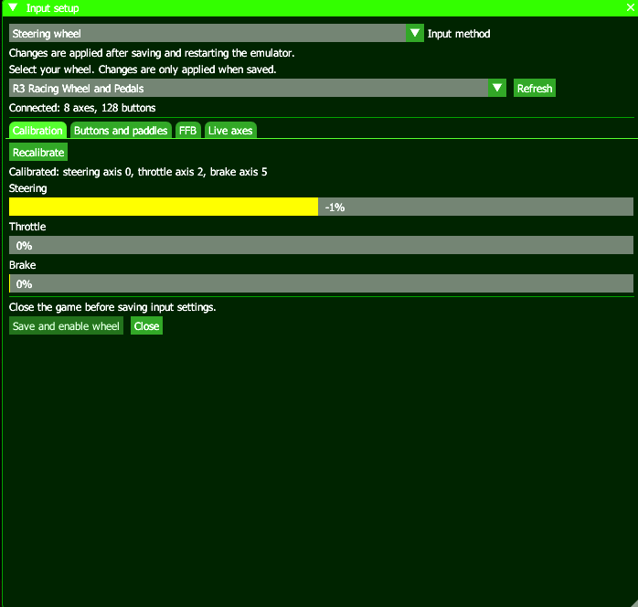

  

<h1 align="center">HercuFork360</h1>

An experimental Xenia Canary fork with steering wheel input and native force feedback.

[HercuFork360](https://github.com/0herculabs/hercufork360) is maintained by
[0herculabs](https://github.com/0herculabs) and is based on
[Xenia Canary](https://github.com/xenia-canary/xenia-canary), the Xbox 360 emulator.
This fork focuses on using PC steering wheels in compatible Xbox 360 games.

## Steering wheel support

- SDL2 wheel input for player 1: steering, independent accelerator and brake,
  buttons, paddles, and the first POV hat.
- An English setup window inside the emulator: **HID > Input setup...**.
- Device selection, guided axis calibration, live input display, and button mapping.
- Native force feedback through the common Xbox 360 `XInputdFF` functions,
  without patches tied to a particular game's executable addresses.
- Constant force, spring, damper, inertia, and friction effects, subject to the
  wheel driver's capabilities.
- Adjustable force gain, steering force inversion, and output that stops when
  focus or guest activity is lost.

**Confirmed by the user:** steering wheel input and native force feedback work
with a **MOZA R3** on Windows in:

| Game | Wheel input | Native FFB |
| --- | --- | --- |
| Forza Motorsport 2 | Confirmed | Confirmed |
| Forza Motorsport 3 | Confirmed | Confirmed |
| Forza Motorsport 4 | Confirmed | Confirmed |

These are user-reported physical tests. Game editions/title updates and wheel
driver versions were not recorded; other combinations still need testing.

FFB remains experimental. Periodic and ramp effects, a proportional clutch,
and pedals connected as a separate USB device are not currently implemented.
Gamepad rumble is not converted into steering torque.

## Wheel setup

1. Connect your wheel in PC mode and open **HID > Input setup...** without a game running.
2. Choose **Steering wheel** under **Input method**, select your device, and
   complete **Calibration > Start guided calibration**.
3. Configure **Buttons and paddles** and check the live steering and pedal bars.
4. In **FFB**, select **Enable native FFB**. Start with **10% gain** and increase gradually.
5. Select **Save and enable wheel**, then restart the emulator.
6. Launch a wheel-compatible game and configure its own controls and FFB settings.

See [the detailed wheel and FFB guide](docs/wheel-ffb.md) for configuration,
limitations, diagnostics, and tests. The setup window uses English; the detailed
setup guide is primarily in Spanish.

### Switching between controller and wheel

Open **HID > Input setup...** and choose **Controller** or **Steering wheel**
under **Input method**. Controller mode offers **Automatic**, **Xbox controller
(XInput)** on Windows, and **Controller (SDL)**. Save without a game running,
then restart the emulator. Controller mode disables wheel input and FFB while
keeping the selected wheel, calibration, button mapping and FFB settings.
Choose **Steering wheel** and save again to restore wheel mode.

## Getting started

Use the [Xenia Canary quickstart](https://github.com/xenia-canary/xenia-canary/wiki/Quickstart)
for general emulator setup and the
[upstream FAQ](https://github.com/xenia-canary/xenia-canary/wiki/FAQ) for common questions.

Check this fork's [Actions](https://github.com/0herculabs/hercufork360/actions)
and [Releases](https://github.com/0herculabs/hercufork360/releases) for available
builds. Upstream Xenia Canary downloads do not include this fork's wheel changes.
Local build executables and configuration files are not included in the source repository.

## Can this release add wheel support to an existing Canary or Edge build?

The release ZIP contains a complete **HercuFork360 executable**, not an add-on,
DLL, or universal binary patch. Wheel input, the setup window, and native FFB
are compiled into the emulator's HID, SDL, and kernel code.

| What you do | Result |
| --- | --- |
| Extract our ZIP to its own folder and run its `xenia_canary.exe` | Run HercuFork360 with the implemented wheel/FFB support. |
| Copy only our configuration into an unmodified Canary or Edge release | Does not add the implementation to that executable. |
| Replace another release's executable with ours | Run HercuFork360; this does not preserve that other executable's version-specific changes. |
| Port our source changes to a chosen Canary or Edge revision and rebuild it | Can produce a separate build combining that revision with wheel support, after integration and testing. |

To use **this release**, extract it separately, run its executable, and configure
**HID > Input setup...**. Keep your original emulator folder and settings so you
can switch back. Configure and test each variant independently; our ZIP does
not provide a configuration migration tool.

To create a **Canary + FFB** or **Edge + FFB release**, a developer must use the
source revision corresponding to the desired release, integrate this fork's
HID/SDL backend, native `XInputdFF` exports, lifecycle handling and setup UI,
resolve API/build differences, then compile and package a new executable.
The first release's implementation is in commits `3390f297a` and `c935c37c0`.
See the target project's own build instructions:
[Xenia Canary](https://github.com/xenia-canary/xenia-canary) and
[Xenia Edge (has207)](https://github.com/has207/xenia-edge).
This is a source port, not a modification performed by extracting our ZIP.

**Available and tested:** the HercuFork360 Windows x64 release, with user-reported
MOZA R3 input and FFB in FM2, FM3, and FM4. A separate Edge executable has not
been built or tested here. No compatibility with arbitrary prebuilt releases
is claimed.

## Compatibility and bug reports

The [upstream compatibility tracker](https://github.com/xenia-canary/game-compatibility/issues)
tracks general game emulation. It does not verify this fork's wheel or FFB support.
Report fork-specific issues in
[HercuFork360 Issues](https://github.com/0herculabs/hercufork360/issues), including
the game/version, wheel model, driver version, and relevant wheel log messages.

## Building and testing

See [building.md](docs/building.md) for dependencies and the usual build workflow.
Optional wheel tests can be enabled in CMake with `-DXENIA_BUILD_WHEEL_TESTS=ON`.
They cover calibration, virtual wheel input, effect translation, the native FFB
protocol, FM2's five-slot activation sequence, and the PowerPC guest hook helper.
They do not replace physical wheel testing.

Follow the [style guide](docs/style_guide.md) and
[contribution guidelines](.github/CONTRIBUTING.md) when contributing.

See [CHANGELOG.md](CHANGELOG.md) for release notes.

## Credits and license

Thanks to the Xenia and Xenia Canary contributors for the emulator this fork
builds on. The native wheel effect translation was adapted from the local
FM4-recomp implementation; game physics and force calculations remain in the game.
No game executables, generated game code, or game assets are included.

HercuFork360 is an independent fork and is not an official Xenia Canary release.
See [LICENSE](LICENSE) and the individual third-party licenses for licensing terms.
The project is intended for emulation research and use with legally obtained games.
